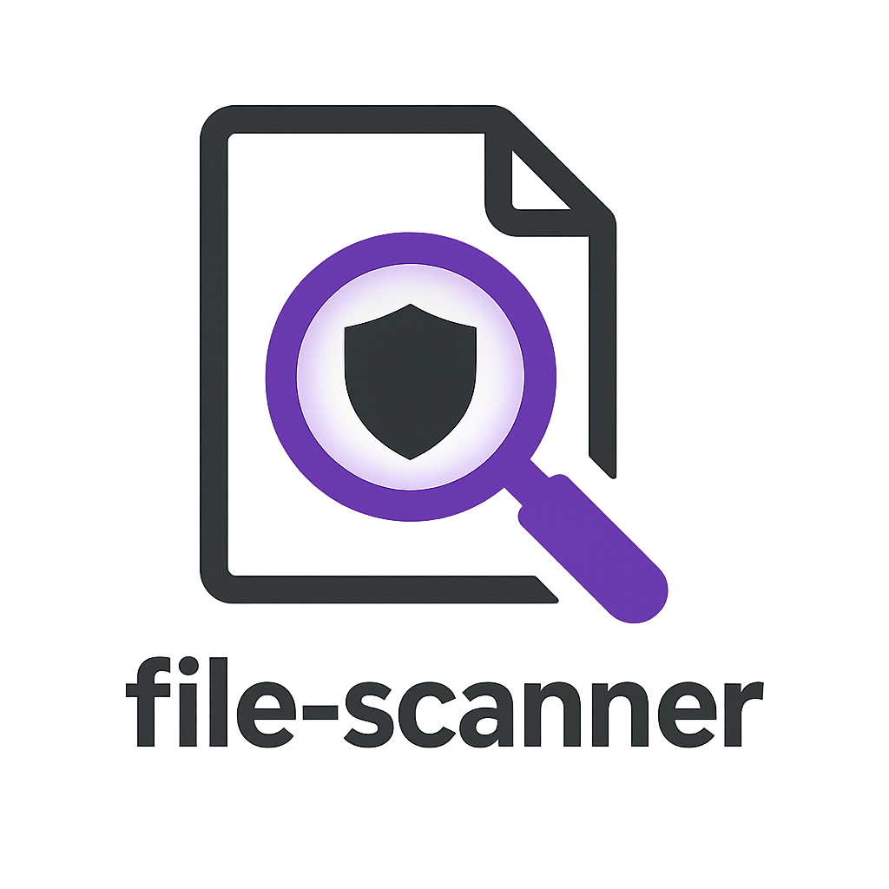

# File Scanner



[](https://github.com/ThreatFlux/file-scanner/actions)
[](https://github.com/ThreatFlux/file-scanner/actions)
[](https://github.com/ThreatFlux/file-scanner/actions)
[](https://codecov.io/github/ThreatFlux/file-scanner)
[](https://www.rust-lang.org)
[](https://opensource.org/licenses/MIT)
[](CONTRIBUTING.md)
[](https://modelcontextprotocol.io)

A static file analyzer for security research, malware triage and forensics, with an MCP server for AI assistants.

[Documentation](docs/) | [Installation](docs/INSTALLATION.md) | [MCP guide](docs/MCP.md) | [Usage](docs/USAGE.md) |
[API](docs/API.md) | [Contributing](CONTRIBUTING.md)

---

## Overview

File Scanner is a native tool written in Rust. It reads files and reports what they contain: metadata, hashes,
strings, binary structure, entropy, imports, disassembly, signatures, YARA matches and heuristic threat indicators. It
never runs the files it analyzes. You can use it from the command line, as a Rust library, or as an MCP server that
AI assistants call as a set of tools.

### Features

- **Binaries**: ELF, PE and Mach-O (thin and universal) parsing, symbols, imports, control flow, disassembly and
  heuristic vulnerability checks
- **Strings and entropy**: ASCII and UTF-16 strings with categories (URLs, IPs, paths, secrets), packing and
  encryption indicators
- **Documents, scripts, archives**: PDF and Office macro triage, shell, PowerShell, JavaScript, Python, batch and
  VBScript analysis, and zip, tar, RAR and 7z listing with risk flags
- **Packages**: offline checks of npm and Python packages and of Java archives (JAR, WAR, EAR, AAR, APK)
- **YARA**: scan files and directories with your own rules or the built-in set
- **MCP server**: 17 tools over stdio and Streamable HTTP, built to give an overview first and paged detail on
  request. See [docs/MCP.md](docs/MCP.md)

Results are heuristics. Offline vulnerability data is a small built-in table. See the Limits section of
[docs/MCP.md](docs/MCP.md#limits).

## Built on ThreatFlux libraries

| Library | Purpose |
| --- | --- |
| [threatflux-string-analysis](https://crates.io/crates/threatflux-string-analysis) | String extraction and analysis |
| [threatflux-binary-analysis](https://crates.io/crates/threatflux-binary-analysis) | PE, ELF and Mach-O parsing |
| [threatflux-threat-detection](https://crates.io/crates/threatflux-threat-detection) | Threat engine, built-in rules |

## Quick Start

### Installation

```bash
# Clone and build
git clone https://github.com/ThreatFlux/file-scanner.git
cd file-scanner
cargo build --release --locked

# Or install directly from source
cargo install --path . --locked
```

[GitHub Releases](https://github.com/ThreatFlux/file-scanner/releases) carry
prebuilt binaries with SHA-256 checksums; releases cut by the release workflow
cover Linux (x86_64, arm64), macOS (arm64, x86_64) and Windows (x86_64) and
attach a CycloneDX SBOM. Container images are published to
`ghcr.io/threatflux/file-scanner`.

#### From crates.io

On crates.io the crate is named `threatflux-file-scanner`, because the
`file-scanner` name belongs to an unrelated crate (`cargo install file-scanner`
does not install this project). It installs the same `file-scanner` binary:

```bash
cargo install threatflux-file-scanner --locked
```

Until [crates.io](https://crates.io/crates/threatflux-file-scanner) lists a
release, install from source or GitHub Releases instead. As a library, add
`threatflux-file-scanner` to `Cargo.toml` and import it as `file_scanner`.

The crates.io build resolves the upstream YARA-X 1.22.0 release, which pins
Wasmtime 48.0.6. Release binaries and container images build from this repository
with the vendored YARA-X security patch (Wasmtime 49.0.5); see
[vendor/README.md](vendor/README.md) for why the crates.io build is not exposed
to the Wasmtime advisories that patch addresses.

### Basic Usage

```bash
# Simple file scan
file-scanner /bin/ls

# Every analysis
file-scanner /path/to/file --all

# Specific analyses
file-scanner file.exe --strings --hex-dump --verify-signatures

# Output formats
file-scanner file.bin --format json > analysis.json
file-scanner file.bin --format yaml
```

### MCP server

```bash
# stdio: the client starts the server as a child process
claude mcp add file-scanner -- /absolute/path/to/file-scanner mcp-stdio

# HTTP: listens on 127.0.0.1 only unless you change --host
file-scanner mcp-http --port 3000
```

Setup for Claude Code, Claude Desktop, Cursor and VS Code, the tool reference, worked examples, the security model
and the limits are in [docs/MCP.md](docs/MCP.md). The HTTP server has no token by default: if you expose it, set
`--auth-token` and `--allow-root` (see [Docker](#docker) and the guide).

The MCP Registry name of this server, which the registry checks in this README:

mcp-name: io.github.threatflux/file-scanner

## MCP tools

The server has 17 tools. Start with `analyze_file` and a path: it returns an overview and says which call to make next.

| Purpose | Tools |
| --- | --- |
| Overview and drill-down | `analyze_file`, `query_analysis`, `disassemble`, `read_hex`, `compare_files` |
| Strings | `search_strings`, `string_details` |
| By file kind | `analyze_document`, `analyze_script`, `inspect_archive`, `analyze_java_file` |
| Packages | `analyze_npm_package`, `analyze_python_package` |
| Detection | `llm_analyze_file`, `yara_scan_file` |
| Cache | `cache_status`, `cache_clear` |

Every answer is capped (80,000 bytes by default, adjustable with `max_output_bytes`), lists come back in pages, and
full analysis runs are cached so follow-up calls are fast. Every `next_steps` entry is a `{tool, arguments, gives}`
call that can be sent as written.

`analyze_script` keeps the first 2,000 findings of a whole file; `line_from` and `line_to` scan a range of lines to
reach the rest. `mcp-stdio` exits 0 when stdin closes (after up to 5 seconds for calls that are still running) and on
SIGINT or SIGTERM. With `--allow-root`, the cache and string tools show only entries of files inside a root; counts
and sizes stay global (see [docs/MCP.md](docs/MCP.md#the-cache)).

## Example CLI output

`file-scanner file.bin --format json` prints one JSON document. File facts, `hashes` and `binary_info` are always
there. `extracted_strings`, `signature_info`, `hex_dump`, `symbol_analysis`, `control_flow_analysis`,
`vulnerability_analysis`, `code_quality_analysis`, `dependency_analysis`, `entropy_analysis`, `disassembly`,
`threat_analysis`, `behavioral_analysis` and `yara_indicators` are `null` unless you ask for them with the matching
flag or `--all`. A shortened run on a small ELF test program:

```json
{
  "file_path": "test_programs/c_advanced_binary",
  "file_size": 22088,
  "mime_type": "application/x-elf",
  "hashes": {
    "md5": "5ad5e32b09b23902a6cdd52daf01c235",
    "sha256": "91f09b18aceb91cbcdbf35e98b9ffb21bd91746abdcb00d95c17abd901cad3f0"
  },
  "binary_info": {
    "format": "ELF",
    "architecture": "x86_64",
    "compiler": "GCC/GNU",
    "sections": [ ... ]
  }
}
```

## Development

### Building from Source

```bash
# Release build
cargo build --release --locked

# Run tests
cargo test --workspace

# Run benchmarks
cargo bench
```

### Project Structure

```text
file-scanner/
├── src/
│   ├── main.rs                # CLI and the MCP subcommands
│   ├── lib.rs                 # library entry point (imported as file_scanner)
│   ├── mcp_server.rs          # MCP handler; tools live in src/mcp_server/
│   ├── mcp_transport.rs       # stdio and HTTP startup; src/mcp_transport/ has the HTTP app and REST routes
│   ├── package_scan.rs        # shared by the npm and Python analyzers
│   └── ...                    # one module per analysis (metadata, hash, strings, binary_parser, ...)
├── benches/                   # performance benchmarks
├── tests/                     # unit and integration tests
└── docs/                      # documentation
```

### CI/CD Pipeline

The project uses GitHub Actions workflows:

- **CI** - Build, test, and lint across Linux, macOS, Windows
- **Security Audit** - Dependency scanning, SBOM generation, vulnerability checks
- **Performance Benchmarks** - Continuous performance tracking with history
- **Auto Release** - Automated versioning and release management
- **Docker** - Multi-platform container builds

## Contributing

Development uses Rust **1.99.1**; the consumer MSRV remains **1.97.1**.
The root workspace and the separate `threatflux-package-security` crate are both
checked by `make ci-local`. Workflow validation uses actionlint 1.7.12 and
yamllint 1.38.0; set `ACTIONLINT_BIN` and `YAMLLINT_BIN` for tools outside `PATH`.

We welcome contributions! Please see our [Contributing Guidelines](CONTRIBUTING.md) for details.

```bash
# Fork and clone
git clone https://github.com/YOUR_USERNAME/file-scanner.git
cd file-scanner

# Create feature branch
git checkout -b feature/amazing-feature

# Install repository hooks
make hooks-install

# Make changes and run the full local gate
make ci-local

# Submit pull request
```

## Security

Source builds and Docker images use a documented temporary YARA-X patch with
patched stable Wasmtime. Cargo does not propagate this root override to published
library consumers; see the [patch provenance and distribution limits](vendor/README.md).
The existing RSA advisory exception remains limited to public-key verification.

For security vulnerabilities, please see our [Security Policy](SECURITY.md) or email <security@threatflux.com>.

## Roadmap

See [docs/ROADMAP.md](docs/ROADMAP.md).

## Performance

Benchmark results are tracked at <https://threatflux.github.io/file-scanner/>.

## Docker

```bash
# Pull the published image (or build it locally with: docker build -t ghcr.io/threatflux/file-scanner .)
docker pull ghcr.io/threatflux/file-scanner:latest

# Scan one file; the image's entry point is the scanner, so arguments go straight to it
docker run --rm -v /path/to/files:/data:ro ghcr.io/threatflux/file-scanner /data/file
```

### MCP server in a container

A container only sees what you mount, and tool paths are paths inside the container. For stdio, mount the files at
the same path inside as outside so the paths a client sends are valid in both places:

```bash
claude mcp add file-scanner -- docker run -i --rm \
  -v "$PWD:$PWD:ro" -w "$PWD" ghcr.io/threatflux/file-scanner:latest mcp-stdio
```

For HTTP the server must listen on all container interfaces (`--host 0.0.0.0`). Keep the published port on the host's
loopback unless you set a token, and confine the tools to the mounted directory:

```bash
docker run --rm -p 127.0.0.1:3000:3000 -v "$PWD:/data:ro" ghcr.io/threatflux/file-scanner:latest \
  mcp-http --host 0.0.0.0 --port 3000 --allow-root /data --auth-token "$TOKEN"
```

Clients then send `/data/...` paths and the header `Authorization: Bearer <token>`. If the server must be reachable
under a name other than `localhost`, add `--allowed-host <name>`. The tools return file contents, so never publish the
port without a token. More in [docs/MCP.md](docs/MCP.md#docker).

These MCP recipes were not run for this change: no image with these flags exists until the next release.

The runtime image is based on Chainguard's `glibc-dynamic` (Wolfi): it runs as the unprivileged user 65532 and has no
shell or package manager.

## License

This project is licensed under the MIT License - see the [LICENSE](LICENSE) file for details.

## Acknowledgments

- Built with Rust and its ecosystem
- MCP Rust SDK (`rmcp`)
- Security patterns from MITRE ATT&CK
- Binary parsing powered by goblin and object crates

---

Made by [ThreatFlux](https://github.com/ThreatFlux).
[Report a bug](https://github.com/ThreatFlux/file-scanner/issues) or
[request a feature](https://github.com/ThreatFlux/file-scanner/issues).
